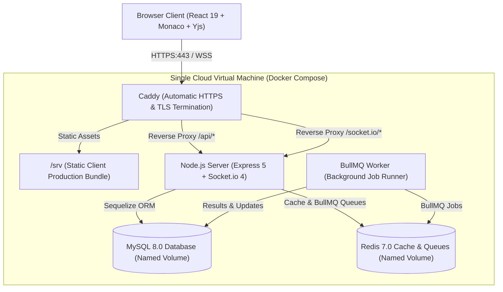

# IntelliPrep AI — Enterprise Technical Assessment & Collaborative Interview Platform

IntelliPrep AI is a production-grade, secure full-stack technical assessment and real-time collaborative interview platform. Built with React 19, Node.js 22, Express 5, Sequelize 6 (MySQL 8), Socket.io 4, Redis 7 (BullMQ), and Yjs CRDTs, it powers live technical interviews, multi-language code execution, AI mock interviews, resume skill extraction with job match analysis, multi-dimensional rubric scoring, and role-scoped analytics.

---

## Table of Contents

- [Features](#features)
- [Architecture](#architecture)
- [Tech Stack](#tech-stack)
- [Honest Demo-Mode Signalling & Capabilities](#honest-demo-mode-signalling--capabilities)
- [Live Demo & Screenshots](#live-demo--screenshots)
- [Security Model & Anti-Leak Guards](#security-model--anti-leak-guards)
- [REST API Reference](#rest-api-reference)
- [Socket.io & Collaborative Events](#socketio--collaborative-events)
- [Local Development Setup](#local-development-setup)
- [Automated Testing & Quality Gates](#automated-testing--quality-gates)
- [Deployment](#deployment)

---

## Features

- **Role-Based Access Control (RBAC)**: Strict 3-tier hierarchy (`candidate`, `interviewer`, `admin`) with cryptographic invitation tokens and refresh token families with automatic reuse detection.
- **Collaborative Coding Room (CRDT)**: Conflict-free real-time code synchronization powered by **Yjs** over Socket.io, with local self-hosted Monaco Editor bundling (zero CDN calls), multi-language syntax highlighting (JavaScript, Python, Java, C++), and server-authoritative observer mode.
- **Interactive Code Execution Runner**: Dedicated `RunCodePanel` executing code against public test cases with custom inputs, asynchronous BullMQ queue processing, hidden test count disclosure without leaking test inputs/outputs, and execution metrics (runtime and memory).
- **AI Mock Technical Practice**: Adaptive AI mock interview sessions powered by Google Gemini SDK with XML-delimiter prompt injection protection, server-authoritative timers, and sequential question progression.
- **Multi-Dimensional Rubric Evaluations**: Server-authoritative weighted scoring across 5 rubric dimensions (Technical Correctness 35%, Problem Solving 25%, Explanation Quality 20%, Relevance 10%, Clarity 10%), human interviewer override controls, and statutory AI advisory disclaimers.
- **Resume Intelligence & Job Matching**: Validated PDF dropzone (`%PDF-` validation, <5MB), canonical skill taxonomy extraction, and Job Description keyword overlap analyzer displaying match percentage and missing skills.
- **Question Bank & Template Management**: Filter technical questions by domain (DSA, System Design, SQL, etc.) and difficulty, author questions with public and hidden test cases, and manage reusable interview templates.
- **Role-Scoped Visual Analytics**: Candidate score progression, skill radars, interviewer score tier distributions, rubric dimension averages, and platform throughput metrics built with Recharts, complete with accessible HTML table fallbacks (WCAG 2.1 AA).
- **Session Scheduling & Clash Detection**: Conflict detection preventing overlapping sessions for candidates and interviewers, with lifecycle state transitions (`scheduled` -> `in_progress` -> `completed` / `cancelled`).
- **Production Single-VM Architecture**: Orchestrated via Docker Compose behind Caddy (automatic HTTPS and reverse proxying), running non-root Node.js 22 containers, MySQL 8, and Redis 7.

---

## Architecture



---

## Tech Stack

| Component | Technology | Description |
|---|---|---|
| **Frontend** | React 19, Vite, Tailwind CSS v4 | Modern accessible SPA with utility-first styling |
| **Code Editor** | `@monaco-editor/react`, `monaco-editor` | Bundled self-hosted Monaco editor (zero external CDN requests) |
| **CRDT Collaboration** | `yjs`, `y-monaco`, `y-protocols` | Real-time conflict-free collaborative editing over WebSockets |
| **Data Visualizations**| `recharts` | Accessible charts with screen-reader HTML data tables (WCAG AA) |
| **Backend Runtime** | Node.js (v22 LTS), Express 5 | REST API routing, rate limiting, and proxy handling (`trust proxy: 1`) |
| **Real-time Sync** | Socket.io (v4) | WebSocket transport with fallback to long-polling and Yjs binary protocol |
| **Database & ORM** | MySQL 8.0, Sequelize 6, Umzug | 23 relational tables, migrations, foreign key cascades, and indexes |
| **Cache & Queues** | Redis 7, BullMQ, `ioredis` | Caching service, job queues, and background execution workers |
| **AI Integration** | Google Gemini SDK (`@google/genai`) | AI mock interviewing, answer analysis, and structured evaluation |
| **Code Execution** | Judge0 API / Sandboxed Runner | Multi-language code execution engine with 2.0s CPU limit and 128MB RAM limit |
| **Reverse Proxy / TLS** | Caddy 2 | Automatic HTTPS certificate issuance, gzip compression, SPA hosting |
| **Testing Harness** | Jest, Vitest, React Testing Library | 138 automated unit & integration tests (128 server + 10 client) |

---

## Honest Demo-Mode Signalling & Capabilities

IntelliPrep AI provides full architectural transparency regarding active subsystem providers:
- **Capabilities Banner**: Persistent banner in the UI queries `GET /api/v1/system/capabilities` and displays badges indicating whether AI evaluation, code execution, or Redis run in live or simulated mode.
- **Production Boot Guard**: If `NODE_ENV === 'production'`, the server refuses to boot with mock AI or mock code execution unless `ALLOW_MOCK_PROVIDERS=true` is explicitly set.
- **Readiness Probe**: `/health/ready` returns `503 Service Unavailable` in production if Redis is running in in-memory fallback mode unless `ALLOW_INMEMORY_REDIS=true` is explicitly configured.
- **Execution Badges**: Every code execution submission clearly displays a "Simulated result" badge when processed by the mock runner.

---

## Live Demo & Screenshots

### Demo Credentials
- **Lead Interviewer**: `interviewer@example.com` / `Test@12345`
- **Candidate**: `candidate@example.com` / `Test@12345`
- **Admin**: Configured via environment during database seeding (`npm run seed:admin`)

### Authentic Live Run Evidence
Screenshots captured from authentic browser runs are located under `docs/screenshots/`:
- `27-system-capabilities-banner.png`: Transparent system capabilities & demo mode disclosure banner
- `19-coding-room-run-code.png`: Live coding room with interactive Run Code panel and test cases
- `20-candidate-evaluation-report.png`: Candidate evaluation report with rubric scores, verified facts, and AI disclaimer
- `28-candidate-resume-match-modal.png`: Resume intelligence dropzone with skill tags and Job Description match %
- `29-candidate-ai-mock-practice.png`: AI mock technical interview practice session with countdown timer
- `30-question-bank-manager.png`: Question bank browser, domain/difficulty filters, authoring modal, and templates
- `31-reports-history-list.png`: Completed assessment reports historical list
- `32-interviewer-human-override.png`: Interviewer evaluation review with human override form

Detailed execution logs and verification evidence can be found in `docs/LIVE_RUN_REPORT_2.md`.

---

## Security Model & Anti-Leak Guards

1. **Cryptographic Algorithm Pinning**: Enforces `algorithms: ['HS256']` on all `jwt.sign()` and `jwt.verify()` operations.
2. **In-Memory JWT Access Tokens**: 15-minute access tokens held strictly in client memory—never in `localStorage`.
3. **Rotated Refresh Token Families**: Refresh tokens are stored in `httpOnly`, `SameSite=Lax` cookies scoped to `/api/auth`. Tokens are SHA-256 hashed in MySQL; detected token reuse immediately revokes the entire family.
4. **Candidate Anti-Leak Data Protection**:
   - Question DTO serialization strictly excludes `referenceKeyPoints` and hidden test case data for candidate requests.
   - Code execution submissions disclose only hidden test pass/fail counts without leaking test inputs, outputs, or error traces.
5. **Prompt Injection Resilience**: Candidate responses are encapsulated within strict XML boundary tags (`<candidate_answer>`, `<candidate_code>`), preventing prompt escape.
6. **Server-Authoritative Evaluation**: Overall scores are calculated strictly through server-side mathematical weighting; AI-suggested arithmetic is never trusted.
7. **Observer Protection**: Sockets connecting as observers have read-only access; editor mutation packets sent by observers are discarded by the server.
8. **Rate Limiting & Reverse Proxy Security**: Distributed rate limiters on authentication routes, helmet security headers with strict CSP, and `trust proxy: 1` configuration behind Caddy.

---

## REST API Reference

All modern endpoints are mounted under `/api/v1` (with `/api` maintained for backwards compatibility):

| Method | Endpoint | Access | Description |
|---|---|---|---|
| `GET` | `/api/health/live` | Public | Liveness probe (`{ status: "ok" }`) |
| `GET` | `/api/health/ready` | Public | Readiness probe evaluating MySQL and Redis connectivity |
| `GET` | `/api/v1/system/capabilities` | Authenticated | Subsystem transparency (AI, execution, Redis, CRDT) |
| `POST` | `/api/v1/auth/register` | Public (Rate-limited) | Register candidate (or interviewer with invitation token) |
| `POST` | `/api/v1/auth/login` | Public (Rate-limited) | Authenticate user, issue access token, set refresh cookie |
| `POST` | `/api/v1/auth/refresh` | Public / Cookie | Rotate refresh token and issue new access token |
| `POST` | `/api/v1/auth/logout` | Authenticated | Revoke refresh token family and clear cookies |
| `GET` | `/api/v1/auth/me` | Authenticated | Return authenticated profile and permissions |
| `POST` | `/api/v1/interviews` | Interviewer | Schedule interview with clash detection |
| `GET` | `/api/v1/interviews` | Authenticated | List user's scheduled and past interviews |
| `GET` | `/api/v1/interviews/:id` | Participant | Retrieve interview details (404 IDOR prevention) |
| `PATCH` | `/api/v1/interviews/:id` | Interviewer | Edit interview details or reschedule |
| `PATCH` | `/api/v1/interviews/:id/status`| Participant | Transition status (`scheduled`, `in_progress`, `completed`, `cancelled`) |
| `GET` | `/api/v1/questions` | Authenticated | List question bank (candidate anti-leak serialized) |
| `POST` | `/api/v1/questions` | Interviewer / Admin | Create question with public and hidden test cases |
| `POST` | `/api/v1/submissions` | Authenticated | Submit code for asynchronous compilation & test execution |
| `GET` | `/api/v1/submissions/:id` | Participant | Query submission status (anti-leak sanitized for candidate) |
| `POST` | `/api/v1/sessions` | Candidate | Create and manage adaptive AI mock interview sessions |
| `POST` | `/api/v1/resumes` | Candidate | Upload PDF resume, extract skills, calculate job match |
| `GET` | `/api/v1/reports` | Authenticated | List completed assessment reports |
| `GET` | `/api/v1/reports/:sessionId` | Participant | Detailed evaluation report with rubrics and disclaimer |
| `POST` | `/api/v1/evaluations/:id/override`| Interviewer | Record human interviewer score override and review notes |
| `GET` | `/api/v1/analytics/:role` | Role-Scoped | Retrieve candidate, interviewer, or admin analytics |
| `GET` | `/api/v1/admin/users` | Admin | List users with pagination and search |
| `POST` | `/api/v1/admin/invitations` | Admin | Provision cryptographic invitation token |

Full schema definitions are available in the OpenAPI 3.1 specification at `docs/api/openapi.yaml`.

---

## Socket.io & Collaborative Events

WebSocket gateway running on `/socket.io`:

| Event | Direction | Payload | Description |
|---|---|---|---|
| `room:join` | Client -> Server | `{ roomId }` | Authorizes participant in DB, binds to room |
| `yjs:sync-step-1` | Both | `Uint8Array` (State Vector) | Yjs CRDT synchronization handshake |
| `yjs:sync-step-2` | Both | `Uint8Array` (Update) | Yjs CRDT document convergence |
| `yjs:update` | Both | `Uint8Array` (Delta) | Real-time incremental CRDT document edit |
| `yjs:awareness` | Both | `Uint8Array` (Presence) | Collaborative cursor position & selection |
| `code:change` | Client -> Server | `{ roomId, code }` | Legacy code update buffer |
| `typing` | Both | `{ roomId }` | Typing indicator broadcast |
| `snapshot:save` | Client -> Server | `{ roomId, note }` | Triggers persistent code snapshot in MySQL |

---

## Local Development Setup

### 1. Database Setup
```sql
CREATE DATABASE interview_platform;
CREATE DATABASE interview_platform_test;
```

### 2. Backend Setup
```bash
cd server
cp .env.example .env
npm install
npm run db:migrate
npm run seed:questions
npm run user:create -- --email interviewer@example.com --name "Lead Interviewer" --role interviewer
npm run dev
```

### 3. Frontend Setup
```bash
cd client
cp .env.example .env
npm install
npm run dev
```
Open `http://localhost:5173` in your browser.

---

## Automated Testing & Quality Gates

IntelliPrep AI enforces strict quality and security gates:

```bash
# Run server test suites (13 suites, 128 tests)
npm test --prefix server

# Run client test suites (4 suites, 10 tests)
npm test --prefix client

# Linting verification
npm run lint --prefix server
npm run lint --prefix client

# Production build verification
npm run build --prefix client

# Legacy socket regression check
cd server && node scripts/socketTest.js
```

**Quality Status:**
- Total Automated Tests: **138 / 138 PASS** (128 server + 10 client)
- ESLint: **0 errors, 0 warnings** (server and client)
- Production Build: **Clean build in 9.00s**
- Security Audit: **0 High/Critical vulnerabilities** (`npm audit --omit=dev --audit-level=high`)

---

## Deployment

For production deployment instructions on a single cloud VM (AWS EC2, GCP Compute Engine, or Ubuntu Server) using Docker Compose, Caddy automatic HTTPS, and non-root container security, consult [DEPLOY.md](./DEPLOY.md) and [docs/MANUAL_STEPS.md](./docs/MANUAL_STEPS.md).
