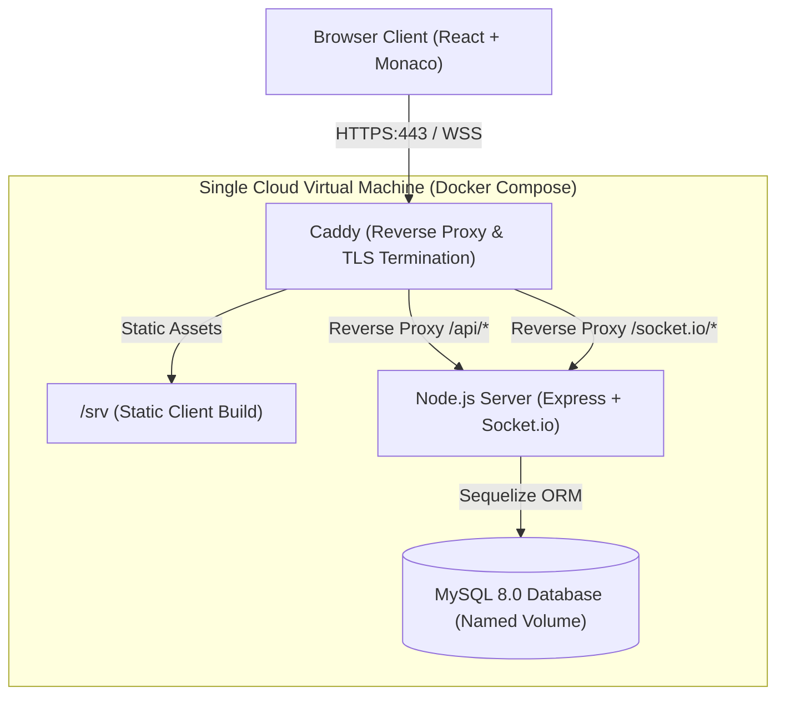

# AI Interview Platform

A full-stack, real-time collaborative technical interview platform built with React, Node.js, Express, Socket.io, Sequelize, and MySQL. It enables interviewers to schedule sessions with clash prevention, conduct live technical interviews with real-time code synchronization in a Monaco editor, manage roles, and track interview statuses.

---

## Table of Contents

- [Features](#features)
- [Architecture](#architecture)
- [Tech Stack](#tech-stack)
- [Live Demo & Screenshots](#live-demo--screenshots)
- [Security Model](#security-model)
- [REST API Reference](#rest-api-reference)
- [Socket.io Events](#socketio-events)
- [Known Limitations & Future Roadmap](#known-limitations--future-roadmap)
- [Local Development Setup](#local-development-setup)
- [Deployment](#deployment)

---

## Features

- **Role-Based Access Control**: Separate workflows for `interviewer` and `candidate` users.
- **Session Scheduling & Clash Detection**: Interviewers can schedule interviews; the system automatically detects scheduling clashes for both participants.
- **Collaborative Coding Room**: Real-time code synchronization using Monaco Editor supporting JavaScript, Python, Java, and C++.
- **Live Presence & Typing Indicators**: Room participant status, connection health indicators, and typing notification broadcasts.
- **Secure Authentication Flow**: Short-lived JWT access tokens held in-memory, paired with rotated refresh tokens stored in `httpOnly` secure cookies.
- **Brute-Force & Rate Limiting Protection**: Configured with `express-rate-limit` across sensitive authentication routes.
- **Production-Ready Single VM Architecture**: Orchestrated via Docker Compose with Caddy serving the SPA and reverse-proxying API and WebSocket traffic under automatic HTTPS.

---

## Architecture

The production architecture is deployed on a single cloud VM (AWS EC2, GCP Compute Engine, or DigitalOcean Droplet) using Docker Compose behind Caddy. Because all static assets, API routes, and WebSocket endpoints share a single origin, cross-origin request issues and cross-site cookie restrictions are completely eliminated.



---

## Tech Stack

| Component | Technology | Description |
|---|---|---|
| **Frontend** | React 19, Vite, Tailwind CSS v4 | Responsive, accessible UI with Tailwind utilities |
| **Code Editor** | `@monaco-editor/react` | VS Code-powered editor supporting multiple programming languages |
| **Client State / Networking** | Axios, React Router v7, `socket.io-client` | In-memory token storage, automatic token refresh interceptor |
| **Backend Runtime** | Node.js (v22 LTS), Express 5 | REST API routing, proxy handling, graceful shutdown |
| **Real-time Sync** | Socket.io (v4) | WebSocket synchronization with fallback to long-polling |
| **Database & ORM** | MySQL 8.0, Sequelize 6 | Relational persistence with foreign keys and indexes |
| **Security & Middleware** | Helmet, Cookie-Parser, express-rate-limit, Joi, bcryptjs | Request sanitization, cookie handling, schema validation |
| **Reverse Proxy / TLS** | Caddy 2 | Automatic TLS certificate issuance, gzip compression, static file serving |
| **Containerization** | Docker, Docker Compose | Multi-stage production container builds and health-checked services |

---

## Live Demo & Screenshots

### Live Demo
- **URL**: `LIVE_URL_HERE`
- **Demo Credentials**:
  - Interviewer: `interviewer@example.com` / `Test@12345`
  - Candidate: `test@example.com` / `Test@12345`

### Screenshots
Screenshots of the application in action are located under `docs/screenshots/`:
- `docs/screenshots/dashboard.png` - Interview dashboard with statistics and filters
- `docs/screenshots/schedule-modal.png` - Schedule new interview modal with clash validation
- `docs/screenshots/coding-room.png` - Real-time Monaco editor room with participant presence

---

## Security Model

1. **Password Hashing**: User passwords are encrypted using `bcryptjs` with 10 salt rounds before storage.
2. **In-Memory JWT Access Tokens**: 15-minute access tokens are held exclusively in JavaScript memory on the frontend—never stored in `localStorage` or `sessionStorage` to mitigate Cross-Site Scripting (XSS) risks.
3. **Rotated Refresh Tokens in httpOnly Cookies**: Refresh tokens are transmitted strictly via `httpOnly`, `SameSite=Lax` cookies scoped to `/api/auth`. Each refresh token is hashed with SHA-256 before being stored in the database. When consumed, the token is revoked and rotated.
4. **Server-Enforced Role-Based Authorization**: Administrative and interviewer actions (scheduling, updating interviews) are protected with server-side authorization middleware (`authorize('interviewer')`).
5. **WebSocket Authentication & Room Authorization**:
   - Connection handshake requires a valid JWT access token verified via `io.use()` middleware.
   - On `room:join`, the database verifies that the socket's authenticated user ID matches either the `interviewerId` or `candidateId` for that specific interview, and ensures the interview is in `scheduled` or `in_progress` status.
6. **Rate Limiting**:
   - Sensitive auth endpoints (`/api/auth/login`, `/api/auth/register`) are throttled to a maximum of 20 requests per 15 minutes per IP.
   - General auth endpoints (`/api/auth/refresh`, `/api/auth/me`) are limited to 200 requests per 15 minutes per IP.
7. **Reverse Proxy Hardening**: `app.set('trust proxy', 1)` enables accurate client IP tracking behind Caddy, and standard security headers are applied via `helmet`.

---

## REST API Reference

Base path: `/api/v1` (with `/api` maintained for backwards-compatibility)

| Method | Endpoint | Access | Description |
|---|---|---|---|
| `GET` | `/health/live` | Public | Liveness probe (`{ status: "ok" }`) |
| `GET` | `/health/ready` | Public | Readiness probe verifying database connectivity (`{ status: "ok", db: "connected" }`) |
| `POST` | `/auth/register` | Public (Rate-limited: 20/15m) | Register a user (`name`, `email`, `password`, `role`) |
| `POST` | `/auth/login` | Public (Rate-limited: 20/15m) | Authenticate user, returns access token, sets refresh cookie |
| `POST` | `/auth/refresh` | Public / Cookie (Rate-limited: 200/15m) | Rotate refresh token and issue new access token |
| `POST` | `/auth/logout` | Authenticated | Revoke refresh token and clear cookie |
| `GET` | `/auth/me` | Authenticated (Rate-limited: 200/15m) | Return authenticated user profile |
| `POST` | `/interviews` | Interviewer | Schedule interview with candidate email, title, time, and clash check |
| `GET` | `/interviews` | Authenticated | List all interviews associated with the authenticated user |
| `GET` | `/interviews/:id` | Authenticated | Retrieve interview details by ID |
| `PATCH` | `/interviews/:id` | Interviewer | Update interview metadata or rescheduled time |
| `PATCH` | `/interviews/:id/status` | Authenticated | Update interview status (`scheduled`, `in_progress`, `completed`, `cancelled`) |

---

## Socket.io Events

The Socket.io gateway runs on `/socket.io` and handles live synchronization during interview sessions:

### Client to Server

| Event | Payload | Description |
|---|---|---|
| `room:join` | `{ roomId: string }` | Verifies user authorization in DB, joins socket room, returns room state and participant list. |
| `code:change` | `{ roomId: string, code: string }` | Updates room code buffer in memory and broadcasts `code:update` to room members. |
| `language:change` | `{ roomId: string, language: string }` | Updates editor language in memory and broadcasts `language:update` to room members. |
| `typing` | `{ roomId: string }` | Broadcasts typing indicator event to other room participants. |

### Server to Client

| Event | Payload | Description |
|---|---|---|
| `code:update` | `{ code: string, from: number }` | Sends updated code buffer emitted by another participant. |
| `language:update` | `{ language: string, from: number }` | Broadcasts new language selection (e.g. `javascript`, `python`). |
| `typing` | `{ userId: number }` | Informs client that a peer is currently typing. |
| `user:joined` | `{ userId: number }` | Informs room participants that a participant joined. |
| `user:left` | `{ userId: number }` | Informs room participants that a participant disconnected. |

---

## Known Limitations & Future Roadmap

- **Concurrency Control**: Code synchronization utilizes a debounced **last-write-wins** model with in-memory room buffers. While ideal for standard interviews where participants typically take turns writing or explaining code, production multi-cursor collaborative environments would migrate to Conflict-free Replicated Data Types (CRDTs) such as **Yjs** or **Automerge**.
- **In-Memory State**: Active room code is stored in-memory on the Node.js server instance. Therefore, the server runs as a single instance. Scaling horizontally across multiple nodes would require a Redis adapter (`@socket.io/redis-adapter`) and a centralized Redis cache for room state.

---

## Local Development Setup

### Prerequisites
- Node.js 22 LTS or later
- MySQL 8.0 running locally
- npm v10+

### 1. Database Setup
Create a local MySQL database:
```sql
CREATE DATABASE interview_platform;
```

### 2. Backend Configuration
Navigate to `server/`:
```bash
cd server
cp .env.example .env
npm install
```
Edit `server/.env` with your local database credentials:
```ini
PORT=5000
NODE_ENV=development
CLIENT_URL=http://localhost:5173
DB_HOST=localhost
DB_NAME=interview_platform
DB_USER=root
DB_PASS=your_local_password
JWT_SECRET=local_jwt_secret_min_32_characters_here
JWT_REFRESH_SECRET=local_refresh_secret_min_32_characters_here
```

Apply database migrations:
```bash
npm run db:migrate
```

Start the backend:
```bash
npm run dev
```

To create an interviewer account locally:
```bash
npm run user:create -- --email interviewer@example.com --name "Lead Interviewer" --role interviewer
```

### 3. Frontend Configuration
In another terminal, navigate to `client/`:
```bash
cd client
npm install
npm run dev
```
Open `http://localhost:5173` in your browser.

### 4. Running Automated Tests & Quality Checks
Run backend automated integration test suites (Auth, Interview Management, Real-Time Sockets):
```bash
cd server
npm test
```
The test suite automatically provisions an isolated database (`interview_platform_test`), verifies 38 end-to-end integration test cases, and asserts that production databases are protected.

Run ESLint and production build validation:
```bash
cd server && npm run lint
cd ../client && npm run lint && npm run build
```

Run real-time socket regression test script:
```bash
cd server
node scripts/socketTest.js
```
All 11 verification checks will print `PASS`.

---

## Deployment

For full instructions on deploying this stack to an AWS EC2 or GCP Compute Engine Ubuntu VM using Docker Compose and Caddy, consult [DEPLOY.md](./DEPLOY.md).
