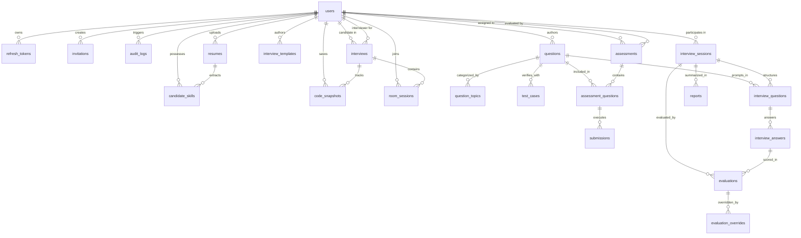

# IntelliPrep AI — Database Architecture & Data Dictionary

Database: `interview_platform`  
Dialect: MySQL 8 (InnoDB Engine, `utf8mb4_unicode_ci`)  
Migration Framework: Umzug (`SequelizeMeta` tracking)  
ORM: Sequelize 6

---

## 1. Entity-Relationship Diagram (ERD)

---

## 2. Comprehensive Data Dictionary

### Core Identity & Access Control

#### `users`
Primary account directory storing authentication credentials, authorization roles, and account status.
- `id` (INT, PK, Auto-Increment)
- `name` (VARCHAR(100), NOT NULL)
- `email` (VARCHAR(150), UNIQUE, NOT NULL, Indexed)
- `passwordHash` (VARCHAR(255), NOT NULL)
- `role` (ENUM('candidate', 'interviewer', 'admin'), DEFAULT 'candidate', NOT NULL)
- `isActive` (BOOLEAN, DEFAULT TRUE, NOT NULL)
- `createdAt` (DATETIME, NOT NULL)
- `updatedAt` (DATETIME, NOT NULL)

#### `refresh_tokens`
Cryptographic token families supporting rotation, reuse detection, and session invalidation.
- `id` (INT, PK, Auto-Increment)
- `userId` (INT, FK -> `users.id`, CASCADE, NOT NULL, Indexed)
- `familyId` (VARCHAR(36), NOT NULL, Indexed) — UUID identifying the token lineage
- `tokenHash` (VARCHAR(64), NOT NULL, Indexed) — SHA-256 hash of the refresh token
- `revokedAt` (DATETIME, NULL) — Timestamp when rotated or invalidated
- `expiresAt` (DATETIME, NOT NULL)
- `createdAt` (DATETIME, NOT NULL)
- `updatedAt` (DATETIME, NOT NULL)

#### `invitations`
Single-use cryptographic invitations for role provisioning (interviewer/admin).
- `id` (INT, PK, Auto-Increment)
- `token` (VARCHAR(64), UNIQUE, NOT NULL, Indexed) — 256-bit secure cryptographic token
- `email` (VARCHAR(150), NOT NULL)
- `role` (ENUM('interviewer', 'admin'), NOT NULL)
- `createdBy` (INT, FK -> `users.id`, SET NULL, NULL)
- `expiresAt` (DATETIME, NOT NULL)
- `usedAt` (DATETIME, NULL)
- `revokedAt` (DATETIME, NULL)
- `createdAt` (DATETIME, NOT NULL)
- `updatedAt` (DATETIME, NOT NULL)

#### `audit_logs`
Immutable security and administrative action audit trail.
- `id` (INT, PK, Auto-Increment)
- `actorId` (INT, FK -> `users.id`, SET NULL, NULL, Indexed)
- `action` (VARCHAR(100), NOT NULL, Indexed)
- `targetType` (VARCHAR(50), NOT NULL)
- `targetId` (VARCHAR(50), NULL)
- `ipAddress` (VARCHAR(45), NULL)
- `metadata` (JSON, NULL)
- `createdAt` (DATETIME, DEFAULT NOW, NOT NULL, Indexed)

---

### Interview Scheduling & Real-Time Rooms

#### `interviews`
Live technical interview appointments and room allocation.
- `id` (INT, PK, Auto-Increment)
- `interviewerId` (INT, FK -> `users.id`, CASCADE, NOT NULL, Indexed)
- `candidateId` (INT, FK -> `users.id`, CASCADE, NOT NULL, Indexed)
- `title` (VARCHAR(150), NOT NULL)
- `scheduledAt` (DATETIME, NOT NULL, Indexed)
- `durationMinutes` (INT, DEFAULT 60, NOT NULL)
- `endAt` (DATETIME, NOT NULL, Indexed) — Denormalized end time for $O(1)$ overlap checks
- `status` (ENUM('scheduled', 'in_progress', 'completed', 'cancelled'), DEFAULT 'scheduled', NOT NULL, Indexed)
- `roomId` (VARCHAR(36), UNIQUE, NOT NULL, Indexed) — UUID collaborative coding room routing key
- `createdAt` (DATETIME, NOT NULL)
- `updatedAt` (DATETIME, NOT NULL)

#### `code_snapshots`
Persistent CRDT state checkpoints and versioned history.
- `id` (INT, PK, Auto-Increment)
- `interviewId` (INT, FK -> `interviews.id`, CASCADE, NOT NULL, Indexed)
- `version` (INT, NOT NULL)
- `code` (MEDIUMTEXT, NOT NULL) — Snapshot of source text up to 50k characters
- `language` (VARCHAR(32), DEFAULT 'javascript', NOT NULL)
- `yjsUpdate` (BLOB, NULL) — Raw binary Yjs document state update
- `source` (VARCHAR(32), DEFAULT 'editor', NOT NULL)
- `savedBy` (INT, FK -> `users.id`, SET NULL, NULL)
- `snapshotTrigger` (ENUM('debounce', 'manual', 'completion'), DEFAULT 'debounce', NOT NULL)
- `createdAt` (DATETIME, NOT NULL, Indexed)
- `updatedAt` (DATETIME, NOT NULL)

#### `room_sessions`
Participant connection and presence audit records.
- `id` (INT, PK, Auto-Increment)
- `interviewId` (INT, FK -> `interviews.id`, CASCADE, NOT NULL, Indexed)
- `userId` (INT, FK -> `users.id`, CASCADE, NOT NULL, Indexed)
- `role` (ENUM('interviewer', 'candidate', 'observer'), NOT NULL)
- `joinedAt` (DATETIME, NOT NULL)
- `leftAt` (DATETIME, NULL)
- `durationSeconds` (INT, DEFAULT 0, NOT NULL)
- `peerSocketId` (VARCHAR(64), NULL)
- `createdAt` (DATETIME, NOT NULL)
- `updatedAt` (DATETIME, NOT NULL)

---

### Question Bank & Assessments

#### `questions`
Repository of algorithmic, conceptual, and system design questions.
- `id` (INT, PK, Auto-Increment)
- `title` (VARCHAR(200), NOT NULL, Indexed)
- `statement` (TEXT, NOT NULL)
- `domain` (VARCHAR(64), NOT NULL, Indexed)
- `difficulty` (ENUM('beginner', 'intermediate', 'advanced'), NOT NULL, Indexed)
- `type` (ENUM('coding', 'conceptual', 'behavioral'), NOT NULL)
- `starterCode` (TEXT, NULL)
- `referenceKeyPoints` (TEXT, NULL) — **Anti-leak protected; never serialized to candidates**
- `createdBy` (INT, FK -> `users.id`, SET NULL, NULL)
- `isArchived` (BOOLEAN, DEFAULT FALSE, NOT NULL, Indexed)
- `createdAt` (DATETIME, NOT NULL)
- `updatedAt` (DATETIME, NOT NULL)

#### `question_topics`
Topic tags for categorical filtering.
- `id` (INT, PK, Auto-Increment)
- `questionId` (INT, FK -> `questions.id`, CASCADE, NOT NULL, Indexed)
- `topic` (VARCHAR(64), NOT NULL, Indexed)

#### `test_cases`
Public and hidden unit test cases.
- `id` (INT, PK, Auto-Increment)
- `questionId` (INT, FK -> `questions.id`, CASCADE, NOT NULL, Indexed)
- `input` (TEXT, NOT NULL)
- `expectedOutput` (TEXT, NOT NULL)
- `isHidden` (BOOLEAN, DEFAULT FALSE, NOT NULL) — **Anti-leak protected**
- `weight` (INT, DEFAULT 1, NOT NULL)
- `timeLimitMs` (INT, DEFAULT 2000, NOT NULL)
- `memoryLimitKb` (INT, DEFAULT 128000, NOT NULL)
- `createdAt` (DATETIME, NOT NULL)
- `updatedAt` (DATETIME, NOT NULL)

#### `interview_templates`
Structured templates for multi-part technical evaluations.
- `id` (INT, PK, Auto-Increment)
- `title` (VARCHAR(150), NOT NULL)
- `description` (TEXT, NULL)
- `domain` (VARCHAR(64), NOT NULL)
- `targetRole` (VARCHAR(64), NULL)
- `structureJson` (JSON, NOT NULL)
- `isDefault` (BOOLEAN, DEFAULT FALSE, NOT NULL)
- `createdBy` (INT, FK -> `users.id`, SET NULL, NULL)
- `createdAt` (DATETIME, NOT NULL)
- `updatedAt` (DATETIME, NOT NULL)

#### `assessments`
Candidate assessment sessions containing question suites.
- `id` (INT, PK, Auto-Increment)
- `candidateId` (INT, FK -> `users.id`, CASCADE, NOT NULL, Indexed)
- `interviewerId` (INT, FK -> `users.id`, SET NULL, NULL)
- `title` (VARCHAR(150), NOT NULL)
- `templateId` (INT, FK -> `interview_templates.id`, SET NULL, NULL)
- `durationMinutes` (INT, DEFAULT 60, NOT NULL)
- `status` (ENUM('draft', 'published', 'in_progress', 'submitted', 'evaluated'), DEFAULT 'draft', NOT NULL)
- `totalScore` (DECIMAL(5,2), NULL)
- `startedAt` (DATETIME, NULL)
- `completedAt` (DATETIME, NULL)
- `createdAt` (DATETIME, NOT NULL)
- `updatedAt` (DATETIME, NOT NULL)

#### `assessment_questions`
Join table linking assessments to specific questions and candidate answers.
- `id` (INT, PK, Auto-Increment)
- `assessmentId` (INT, FK -> `assessments.id`, CASCADE, NOT NULL, Indexed)
- `questionId` (INT, FK -> `questions.id`, CASCADE, NOT NULL, Indexed)
- `orderIndex` (INT, DEFAULT 1, NOT NULL)
- `candidateCode` (MEDIUMTEXT, NULL)
- `language` (VARCHAR(32), NULL)
- `status` (ENUM('unopened', 'in_progress', 'answered'), DEFAULT 'unopened', NOT NULL)
- `executionStatus` (VARCHAR(32), NULL)
- `passedTestCases` (INT, DEFAULT 0, NOT NULL)
- `totalTestCases` (INT, DEFAULT 0, NOT NULL)
- `score` (DECIMAL(5,2), NULL)
- `createdAt` (DATETIME, NOT NULL)
- `updatedAt` (DATETIME, NOT NULL)

#### `submissions`
Asynchronous code execution attempts and sandbox results.
- `id` (INT, PK, Auto-Increment)
- `assessmentQuestionId` (INT, FK -> `assessment_questions.id`, CASCADE, NOT NULL, Indexed)
- `candidateId` (INT, FK -> `users.id`, CASCADE, NOT NULL, Indexed)
- `questionId` (INT, FK -> `questions.id`, CASCADE, NOT NULL, Indexed)
- `sourceCode` (MEDIUMTEXT, NOT NULL)
- `language` (VARCHAR(32), NOT NULL)
- `resultStatus` (ENUM('accepted', 'wrong_answer', 'time_limit_exceeded', 'memory_limit_exceeded', 'runtime_error', 'compilation_error', 'sandbox_error'), NOT NULL)
- `stdout` (TEXT, NULL)
- `stderr` (TEXT, NULL)
- `compileOutput` (TEXT, NULL)
- `passedTestCases` (INT, DEFAULT 0, NOT NULL)
- `totalTestCases` (INT, DEFAULT 0, NOT NULL)
- `runtimeMs` (INT, DEFAULT 0, NOT NULL)
- `memoryKb` (INT, DEFAULT 0, NOT NULL)
- `createdAt` (DATETIME, NOT NULL)
- `updatedAt` (DATETIME, NOT NULL)

---

### AI Sessions, Resume Intelligence & Evaluations

#### `interview_sessions`
Interactive AI mock interview sessions with timer constraints.
- `id` (INT, PK, Auto-Increment)
- `userId` (INT, FK -> `users.id`, CASCADE, NOT NULL, Indexed)
- `interviewerId` (INT, FK -> `users.id`, SET NULL, NULL)
- `type` (ENUM('technical', 'hr', 'mixed'), DEFAULT 'technical', NOT NULL)
- `difficulty` (ENUM('beginner', 'intermediate', 'advanced'), DEFAULT 'intermediate', NOT NULL)
- `status` (ENUM('configured', 'in_progress', 'completed', 'cancelled'), DEFAULT 'configured', NOT NULL)
- `mode` (ENUM('mock', 'live_assisted'), DEFAULT 'mock', NOT NULL)
- `startedAt` (DATETIME, NULL)
- `endsAt` (DATETIME, NULL)
- `durationMinutes` (INT, NOT NULL)
- `score` (DECIMAL(5,2), NULL)
- `summary` (TEXT, NULL)
- `createdAt` (DATETIME, NOT NULL)
- `updatedAt` (DATETIME, NOT NULL)

#### `interview_questions`
Session question schedule and follow-up prompts.
- `id` (INT, PK, Auto-Increment)
- `sessionId` (INT, FK -> `interview_sessions.id`, CASCADE, NOT NULL, Indexed)
- `questionId` (INT, FK -> `questions.id`, SET NULL, NULL)
- `orderIndex` (INT, NOT NULL)
- `questionText` (TEXT, NOT NULL)
- `expectedPoints` (TEXT, NULL)
- `category` (VARCHAR(64), NULL)
- `status` (ENUM('pending', 'active', 'answered', 'skipped'), DEFAULT 'pending', NOT NULL)
- `createdAt` (DATETIME, NOT NULL)
- `updatedAt` (DATETIME, NOT NULL)

#### `interview_answers`
Candidate answers and AI evaluation feedback.
- `id` (INT, PK, Auto-Increment)
- `interviewQuestionId` (INT, FK -> `interview_questions.id`, CASCADE, NOT NULL, Indexed)
- `candidateAnswer` (TEXT, NOT NULL)
- `codeSnippet` (TEXT, NULL)
- `score` (DECIMAL(5,2), NULL)
- `feedback` (TEXT, NULL)
- `technicalCorrectness` (INT, NULL)
- `problemSolving` (INT, NULL)
- `explanationQuality` (INT, NULL)
- `isFollowUp` (BOOLEAN, DEFAULT FALSE, NOT NULL)
- `parentQuestionId` (INT, FK -> `interview_questions.id`, SET NULL, NULL)
- `createdAt` (DATETIME, NOT NULL)
- `updatedAt` (DATETIME, NOT NULL)

#### `ai_usage`
Auditable LLM token telemetry and cost accounting.
- `id` (INT, PK, Auto-Increment)
- `userId` (INT, FK -> `users.id`, SET NULL, NULL, Indexed)
- `purpose` (VARCHAR(64), NOT NULL)
- `promptVersion` (VARCHAR(32), NOT NULL)
- `model` (VARCHAR(64), NOT NULL)
- `inputTokens` (INT, DEFAULT 0, NULL)
- `outputTokens` (INT, DEFAULT 0, NULL)
- `latencyMs` (INT, DEFAULT 0, NULL)
- `status` (ENUM('success', 'failed', 'fallback'), DEFAULT 'success', NOT NULL)
- `errorMessage` (TEXT, NULL)
- `createdAt` (DATETIME, NOT NULL)
- `updatedAt` (DATETIME, NOT NULL)

#### `resumes`
Uploaded candidate CVs and parsing state.
- `id` (INT, PK, Auto-Increment)
- `candidateId` (INT, FK -> `users.id`, CASCADE, NOT NULL, Indexed)
- `originalFilename` (VARCHAR(255), NOT NULL)
- `storagePath` (VARCHAR(512), NOT NULL)
- `mimeType` (VARCHAR(64), DEFAULT 'application/pdf', NOT NULL)
- `fileSizeBytes` (INT, NOT NULL)
- `parsedText` (MEDIUMTEXT, NULL)
- `status` (ENUM('uploaded', 'parsing', 'parsed', 'failed'), DEFAULT 'uploaded', NOT NULL)
- `failureReason` (TEXT, NULL)
- `createdAt` (DATETIME, NOT NULL)
- `updatedAt` (DATETIME, NOT NULL)

#### `candidate_skills`
Normalized technical taxonomy extracted from resumes or verified in assessments.
- `id` (INT, PK, Auto-Increment)
- `candidateId` (INT, FK -> `users.id`, CASCADE, NOT NULL, Indexed)
- `skill` (VARCHAR(100), NOT NULL, Indexed)
- `proficiencyLevel` (ENUM('beginner', 'intermediate', 'expert'), DEFAULT 'intermediate', NOT NULL)
- `verified` (BOOLEAN, DEFAULT FALSE, NOT NULL)
- `yearsExperience` (DECIMAL(3,1), DEFAULT 0.0, NOT NULL)
- `resumeId` (INT, FK -> `resumes.id`, SET NULL, NULL)
- `createdAt` (DATETIME, NOT NULL)
- `updatedAt` (DATETIME, NOT NULL)

#### `evaluations`
Rubric-driven multi-dimensional evaluation results.
- `id` (INT, PK, Auto-Increment)
- `sessionId` (INT, FK -> `interview_sessions.id`, CASCADE, NOT NULL, Indexed)
- `answerId` (INT, FK -> `interview_answers.id`, SET NULL, NULL)
- `technicalCorrectness` (INT, NOT NULL) — 35% Weight
- `problemSolving` (INT, NOT NULL) — 25% Weight
- `explanationQuality` (INT, NOT NULL) — 20% Weight
- `relevance` (INT, NOT NULL) — 10% Weight
- `communicationClarity` (INT, NOT NULL) — 10% Weight
- `overallScore` (DECIMAL(5,2), NOT NULL) — **Server-Authoritative Weighted Calculation**
- `feedbackText` (TEXT, NOT NULL)
- `strengthsJson` (JSON, NULL)
- `weaknessesJson` (JSON, NULL)
- `recommendedTopicsJson` (JSON, NULL)
- `status` (ENUM('pending', 'completed', 'failed'), DEFAULT 'pending', NOT NULL)
- `createdAt` (DATETIME, NOT NULL)
- `updatedAt` (DATETIME, NOT NULL)

#### `evaluation_overrides`
Human interviewer adjustments preserving raw AI evaluations.
- `id` (INT, PK, Auto-Increment)
- `evaluationId` (INT, FK -> `evaluations.id`, CASCADE, NOT NULL, Indexed)
- `reviewerId` (INT, FK -> `users.id`, CASCADE, NOT NULL, Indexed)
- `originalScore` (DECIMAL(5,2), NOT NULL)
- `overrideScore` (DECIMAL(5,2), NOT NULL)
- `reasonNotes` (TEXT, NOT NULL)
- `createdAt` (DATETIME, NOT NULL)
- `updatedAt` (DATETIME, NOT NULL)

#### `reports`
Synthesized final candidate performance reports.
- `id` (INT, PK, Auto-Increment)
- `sessionId` (INT, FK -> `interview_sessions.id`, CASCADE, NOT NULL, Indexed)
- `candidateId` (INT, FK -> `users.id`, CASCADE, NOT NULL, Indexed)
- `verifiedFactsJson` (JSON, NOT NULL)
- `strengthsJson` (JSON, NOT NULL)
- `weaknessesJson` (JSON, NOT NULL)
- `recommendation` (ENUM('strong_hire', 'hire', 'lean_hire', 'lean_no_hire', 'no_hire'), NOT NULL)
- `reportPdfPath` (VARCHAR(512), NULL)
- `createdAt` (DATETIME, NOT NULL)
- `updatedAt` (DATETIME, NOT NULL)

---

## 3. Migration Sequence & Idempotency

All database changes are applied using Umzug migrations located in `server/src/migrations/`:
1. `001_baseline_idempotent.js`: Safe baseline provisioning for legacy schema compatibility.
2. `002_rbac_invitations_audit.js`: Provisions token families, invitations, and audit logs.
3. `003_questions_and_assessments.js`: Establishes question bank, templates, test cases, and candidate assessments.
4. `004_code_execution_submissions.js`: Creates code submission records and test result metrics.
5. `005_ai_engine_and_resumes.js`: Provisions sessions, resume records, and candidate skills.
6. `006_evaluations_and_reports.js`: Adds rubric evaluations, human overrides, and report synthesis.
7. `007_collaborative_editor_snapshots.js`: Creates code snapshots with BLOB updates and room telemetry.

Every migration verifies existing columns and tables using `queryInterface.showAllTables()` and `queryInterface.describeTable()` before executing DDL, ensuring 100% idempotent application.
