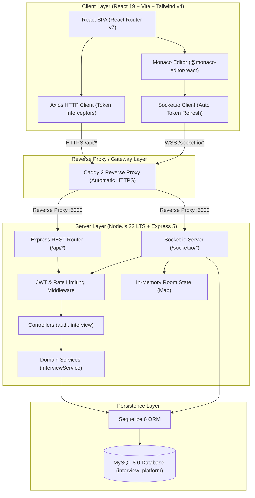

# IntelliPrep AI — Comprehensive Repository & Architecture Audit Report

**Date of Audit:** November 7, 2026  
**Repository Location:** `D:\ai-interview-platform`  
**Current Baseline Commit:** `1075f48` (`feature/deploy`)  
**Safety Backup Branch:** `backup/pre-intelliprep`  
**Safety Tag:** `pre-intelliprep`  
**Database Backup:** `D:\db_backups\interview_platform_pre_intelliprep.sql` (5,314 bytes, created via `mysqldump`)  
**Auditor:** Antigravity (Google DeepMind)

---

## 1. Executive Summary

This repository audit assesses the current state of the **AI Interview Platform** to establish a baseline prior to the phased enterprise upgrade into **IntelliPrep AI**. 

The existing codebase consists of a functional monolithic Express backend and a React (Vite) single-page frontend. Core capabilities—such as user authentication (JWT + rotated refresh token cookies), basic interview scheduling with conflict detection, and live collaborative coding via Socket.io and Monaco Editor—are present and operational.

However, the application currently lacks production-grade foundations:
- Automated tests are almost non-existent (only a single 11-step Socket.io script exists; no HTTP or unit tests exist in the repository).
- Public registration allows any user to self-assign the `interviewer` role.
- Database changes are managed via `sequelize.sync()`, with no versioned migration framework or database indexes on query-critical fields.
- Monaco Editor depends on an external CDN by default, and `dompurify` in the client has an active **critical severity** vulnerability.
- Code room state is stored purely in Node.js server memory with last-write-wins synchronization.
- Source files across both backend and frontend contain colloquial Hinglish comments.

---

## 2. Architecture Map

### 2.1 Component Overview



### 2.2 System Flow
1. **Authentication**: Users submit email/password to `/api/auth/login`. The server issues an in-memory 15-minute JWT access token and sets an `httpOnly`, `SameSite=Lax` refresh cookie scoped to `/api/auth`.
2. **Scheduling**: Interviewers schedule sessions via `/api/interviews`. The backend executes clash detection across active sessions (`scheduled`, `in_progress`) for both candidate and interviewer.
3. **Collaborative Room**: Sockets authenticate during handshake via access token. Sockets join a room via `room:join` which verifies that the user is a designated participant in that session in the database. Code changes are broadcast to room peers using debounced events.

---

## 3. API Route Inventory

All existing routes are mounted under `/api` in `server/src/app.js`:

| Method | Route | Authentication | Role Required | Request Body / Query Params | Response Summary | Controller / Handler |
|---|---|---|---|---|---|---|
| `GET` | `/api/health` | Public | None | None | `{ status: "ok" }` | Inline handler |
| `POST` | `/api/auth/register` | Public (Rate-limited: 20/15m) | None (Self-selects role) | `{ name, email, password, role? }` | `201 Created`: `{ user: { id, name, email, role } }` | `authController.register` |
| `POST` | `/api/auth/login` | Public (Rate-limited: 20/15m) | None | `{ email, password }` | `200 OK`: `{ accessToken, user }` + `Set-Cookie: refreshToken` | `authController.login` |
| `POST` | `/api/auth/refresh` | Cookie (Rate-limited: 200/15m) | None | Cookie: `refreshToken` | `200 OK`: `{ accessToken }` + Rotated `Set-Cookie: refreshToken` | `authController.refresh` |
| `POST` | `/api/auth/logout` | Optional Cookie | None | Cookie: `refreshToken` | `200 OK`: `{ message: "Logged out" }` + Cleared cookie | `authController.logout` |
| `GET` | `/api/auth/me` | Bearer Token (Rate-limited: 200/15m) | Any valid user | Headers: `Authorization: Bearer <token>` | `200 OK`: `{ user: { id, name, email, role } }` | `authController.me` |
| `POST` | `/api/interviews` | Bearer Token | `interviewer` | `{ candidateEmail, title, scheduledAt, durationMinutes }` | `201 Created`: `{ interview }` | `interviewController.create` |
| `GET` | `/api/interviews` | Bearer Token | Any valid user | Query: `?status=(scheduled\|in_progress\|completed\|cancelled)` | `200 OK`: `{ interviews: [...] }` | `interviewController.list` |
| `GET` | `/api/interviews/:id` | Bearer Token | Participant only | Param: `:id` | `200 OK`: `{ interview }` (or `404 Not Found` if not a participant) | `interviewController.getOne` |
| `PATCH` | `/api/interviews/:id` | Bearer Token | `interviewer` (Participant) | Param: `:id`, Body: `{ title?, scheduledAt?, durationMinutes? }` | `200 OK`: `{ interview }` | `interviewController.update` |
| `PATCH` | `/api/interviews/:id/status` | Bearer Token | Participant (Interviewer for start/complete; Candidate for cancel) | Param: `:id`, Body: `{ status }` | `200 OK`: `{ interview }` | `interviewController.updateStatus` |

---

## 4. Socket.io Event Specification

Socket server attaches to HTTP server via `server/src/sockets/index.js`. Handshake authentication requires `{ token }` in `socket.handshake.auth`.

| Event | Direction | Payload | Validation & Authorization | Behavior / Response |
|---|---|---|---|---|
| `room:join` | Client -> Server | `{ roomId: string }` | Validates `roomId` string; executes DB query ensuring user is `interviewerId` or `candidateId` and status is `scheduled` or `in_progress`. | Joins socket room; emits `user:joined` to peers; calls ack callback with `{ ok: true, code, language, participants }`. |
| `code:change` | Client -> Server | `{ roomId: string, code: string }` | Sockets must belong to `socket.rooms.has(roomId)`; code length must be `<= 50000`. | Updates in-memory buffer `room.code`; broadcasts `code:update` (`{ code, from }`) to all peers in room. |
| `language:change` | Client -> Server | `{ roomId: string, language: string }` | Sockets must belong to room; language must be in `['javascript', 'python', 'java', 'cpp']`. | Updates in-memory buffer `room.language`; broadcasts `language:update` (`{ language, from }`) to peers. |
| `typing` | Client -> Server | `{ roomId: string }` | Sockets must belong to room. | Broadcasts `typing` (`{ userId }`) to peers in room. |
| `disconnecting` | Internal | None | None | Broadcasts `user:left` (`{ userId }`) to all rooms the socket was member of. |
| `disconnect` | Internal | None | None | If room becomes empty, schedules memory cleanup timer (10 minutes). |

---

## 5. Database Schema & Drift Analysis

### 5.1 Real MySQL Schema (`interview_platform`)

#### Table: `users`
```sql
CREATE TABLE `users` (
  `id` int NOT NULL AUTO_INCREMENT,
  `name` varchar(100) NOT NULL,
  `email` varchar(150) NOT NULL,
  `passwordHash` varchar(255) NOT NULL,
  `role` enum('candidate','interviewer') NOT NULL DEFAULT 'candidate',
  `refreshToken` text,
  `createdAt` datetime NOT NULL,
  `updatedAt` datetime NOT NULL,
  PRIMARY KEY (`id`),
  UNIQUE KEY `email` (`email`)
) ENGINE=InnoDB AUTO_INCREMENT=6 DEFAULT CHARSET=utf8mb4 COLLATE=utf8mb4_0900_ai_ci;
```

#### Table: `interviews`
```sql
CREATE TABLE `interviews` (
  `id` int NOT NULL AUTO_INCREMENT,
  `interviewerId` int NOT NULL,
  `candidateId` int NOT NULL,
  `title` varchar(150) NOT NULL,
  `scheduledAt` datetime NOT NULL,
  `durationMinutes` int NOT NULL DEFAULT '60',
  `endAt` datetime NOT NULL,
  `status` enum('scheduled','in_progress','completed','cancelled') NOT NULL DEFAULT 'scheduled',
  `roomId` char(36) CHARACTER SET utf8mb4 COLLATE utf8mb4_bin NOT NULL,
  `createdAt` datetime NOT NULL,
  `updatedAt` datetime NOT NULL,
  PRIMARY KEY (`id`),
  KEY `interviewerId` (`interviewerId`),
  KEY `candidateId` (`candidateId`),
  CONSTRAINT `interviews_ibfk_1` FOREIGN KEY (`interviewerId`) REFERENCES `users` (`id`) ON DELETE CASCADE ON UPDATE CASCADE,
  CONSTRAINT `interviews_ibfk_2` FOREIGN KEY (`candidateId`) REFERENCES `users` (`id`) ON DELETE CASCADE ON UPDATE CASCADE
) ENGINE=InnoDB AUTO_INCREMENT=5 DEFAULT CHARSET=utf8mb4 COLLATE=utf8mb4_0900_ai_ci;
```

### 5.2 Schema Drift & Index Gap Analysis
1. **`roomId` Unique Constraint Missing**: While `Interview.js` specifies `DataTypes.UUIDV4`, the actual database table has no `UNIQUE` constraint or unique index on `roomId`.
2. **Missing Query Indexes**:
   - `interviews` is continuously queried on `(interviewerId, scheduledAt)` and `(candidateId, scheduledAt)` for dashboard sorting and conflict detection. No compound index exists.
   - `interviews` filter queries use `status`, but no index on `status` exists.
   - Clash detection queries use `status`, `scheduledAt`, and `endAt`.
3. **No Migration System**: Schema synchronization currently relies solely on `sequelize.sync()`. There is no `Sequelize CLI` or `Umzug` migration table (`SequelizeMeta`) in the database.

---

## 6. Baseline Verification Results

### 6.1 Socket & Real-Time Test (`server/scripts/socketTest.js`)
Executed against local running server (Port 5000) and MySQL:
```text
PASS interview created, roomId received
PASS no token -> connection rejected
PASS outsider cannot join the room
PASS interviewer joined
PASS candidate joined, 2 participants
PASS interviewer notified that candidate joined
PASS code synced to candidate
PASS typing indicator received
PASS outsider cannot push code into the room
PASS interviewer notified that candidate left
PASS reconnected candidate got the latest code
```
**Result**: 11 out of 11 checks PASSED.

### 6.2 Client Lint & Build (`npm run lint && npm run build`)
- **`npm run lint`**: Clean exit (`0 errors`, `0 warnings`).
- **`npm run build`**:
```text
vite v8.3.5 building client environment for production...
transforming...
✓ 136 modules transformed.
rendering chunks...
computing gzip size...
dist/index.html                   0.64 kB │ gzip:   0.38 kB
dist/assets/index-DoHO1M3b.css   19.82 kB │ gzip:   4.57 kB
dist/assets/index-BBEX7dCq.js   391.04 kB │ gzip: 126.12 kB
✓ built in 1.09s
```
**Result**: PASSED.

### 6.3 Security Dependency Audit (`npm audit`)
- **Server Audit**:
  - Found **22 vulnerabilities** (3 low, 19 moderate).
  - Main culprits: `minimatch` and `glob` (transitive via `jest` 30 and `nodemon`), and `uuid` (transitive via `sequelize` 6.37).
  - Critical/High count: **0 critical, 0 high**.
- **Client Audit**:
  - Found **6 vulnerabilities** (1 low, 4 moderate, **1 CRITICAL**).
  - Critical finding: `dompurify <=3.4.16` (DOM XSS in node-removing afterSanitize hook / prototype poisoning). Transitive dependency of `monaco-editor@0.57.0`.

### 6.4 Automated Test Suite Audit
- **Unit / Integration Tests**: **0 test files found in repository**.
- All previous testing of auth (9 checks) and scheduling (18 checks) was performed via ad-hoc interactive scripts, with no automated Jest or Supertest specs checked into git.

---

## 7. Status of Suspected Known Issues

| # | Suspected Issue | Audit Finding & Evidence | Status |
|---|---|---|---|
| 1 | **Public signup lets anyone choose the interviewer role.** | `authValidator.js` line 7 validates `role: Joi.string().valid('candidate', 'interviewer')` and `authController.js` creates the user with whatever `role` is supplied in the request body. | **CONFIRMED** |
| 2 | **The temporary route `GET /api/auth/interviewer-check` may still exist.** | On `main` it exists. On the current `feature/deploy` branch, it was removed during the previous hardening commit `c88dfe1`. | **CONFIRMED (Historical / Main)**; Resolved on `feature/deploy`. |
| 3 | **Server startup uses `sequelize.sync()` and there are no migrations.** | `server.js` calls `await sequelize.sync()`. No migration tooling (`Umzug` / `Sequelize CLI`) or migration files exist. | **CONFIRMED** |
| 4 | **Room state and code live in server memory only; sync is last-write-wins.** | `sockets/index.js` holds a `Map` instance `rooms`. Broadcasts emit the entire buffer without operational transformation or CRDTs. Reboots lose code. | **CONFIRMED** |
| 5 | **API and socket URLs fall back to localhost and cookies use `SameSite=Lax`.** | `http.js` and `socket.js` fall back to `http://localhost:5000` when not in production. Auth cookies are issued with `sameSite: 'lax'`, necessitating single-origin deployment or an explicit reverse proxy. | **CONFIRMED** |
| 6 | **The client `npm audit` reported a critical vulnerability.** | `npm audit` in `client/` reports **1 Critical Severity** vulnerability in `dompurify <=3.4.16` via `monaco-editor`. | **CONFIRMED** |
| 7 | **Monaco loads from a CDN (blocks a strict CSP and offline use).** | `Room.jsx` utilizes default `@monaco-editor/react` which dynamically fetches AMD loaders and workers from `cdn.jsdelivr.net`. | **CONFIRMED** |
| 8 | **The candidate dashboard does not refresh live.** | `Dashboard.jsx` fetches interviews only once upon mounting via `useEffect`. There is no polling, SSE, or WebSocket event listener for status transitions. | **CONFIRMED** |
| 9 | **The local database contains test data.** | MySQL `users` table contains 5 user records (`test@example.com`, `interviewer@example.com`, `outsider@example.com`, `rana234@gmail.com`, `tanwar222@gmail.com`) and `interviews` contains 4 test records. | **CONFIRMED** |

---

## 8. Security Findings

1. **Unpinned JWT Verification Algorithm**:
   - `server/src/middleware/auth.js` and `server/src/controllers/authController.js` call `jwt.verify(token, secret)` without specifying `{ algorithms: ['HS256'] }`. This leaves the system vulnerable to algorithm confusion attacks (e.g., token forged with algorithm `none` or public key confusion).
2. **Missing Token Family & Revocation Tracking**:
   - `users.refreshToken` only stores the single latest token hash. It does not track token families or handle concurrent device logins, nor does it detect token reuse to revoke the session hierarchy.
3. **Password Policy Minimums**:
   - `authValidator.js` enforces a minimum password length of 8 characters with bcrypt cost factor 10. Enterprise standard requires a minimum length of 10-12 characters, cost factor >= 12, and check against common passwords.
4. **Lack of Centralized Error Shielding**:
   - `middleware/errorHandler.js` returns `err.message` directly to the client on 500 status codes, risking internal implementation and database error leakage.
5. **No Request ID Tracing**:
   - Requests lack unique correlation IDs (`X-Request-Id`), making distributed auditing and error forensics difficult.

---

## 9. Technical Debt & Code Quality

1. **Hinglish Comments Across Codebase**:
   - Numerous source files (`User.js`, `Interview.js`, `authController.js`, `interviewController.js`, `interviewService.js`, `sockets/index.js`, `Room.jsx`) contain colloquial Hinglish comments (e.g., `// refresh wale step me use hoga`, `// Abhi memory me hai, server restart par chala jata hai`, `// Sirf wahi interview milegi jisme user participant hai`). These must be refactored into clear, professional English.
2. **Missing DTO / Response Serializers**:
   - Queries directly return model instances or raw objects without a strict projection layer, risking accidental leakage of sensitive internal columns.
3. **Direct Database Syncing**:
   - Running `sequelize.sync()` on startup in production is inherently risky and cannot perform non-destructive schema migrations or rollbacks.

---

## 10. Technical Risks & Constraints

1. **Single-Instance Memory Constraint**: Because active interview code buffers and connected socket IDs reside in Node.js process memory (`Map`), the server must run strictly as a single container instance until Redis and Yjs are introduced.
2. **Judge0 & Sandbox Footprint**: Self-hosting Judge0 CE requires privileged containers and 2-4 GB of RAM, which exceeds micro cloud VM limits (1-2 GB). A hosted Judge0 endpoint or lightweight sandbox fallback is required.
3. **Database Test Isolation**: Adding comprehensive integration test suites (Supertest) requires a separate, dedicated test database so existing development and test records in `interview_platform` are never dropped or mutated.

---

## 11. Concrete Execution Plan for Phase 1

### Phase 1 Objective: Foundation, Quality, and Deploy-Readiness (P0)
Establish automated testing, environment validation, structured logging, centralized error handling, API versioning (`/api/v1`), security hardening, and safe database migrations without breaking any existing functionality.

### File Plan for Phase 1:
- **MODIFY**:
  - `server/src/app.js`: Mount `/api/v1` routes, add correlation ID middleware, structured logger (pino/pino-http), centralized error handler with `AppError`. Keep temporary `/api` alias for backwards compatibility.
  - `server/src/server.js`: Integrate schema-validated environment configuration module, graceful shutdown, health endpoints (`/health/live`, `/health/ready`), disable `sequelize.sync()` outside test environments.
  - `server/src/models/User.js` & `Interview.js`: Translate Hinglish comments to English; prepare associations.
  - `server/src/controllers/authController.js`: Pin JWT algorithms to `HS256`, enforce candidate-only registration by default, translate Hinglish comments.
  - `server/src/controllers/interviewController.js`: Translate comments, integrate standardized error responses.
  - `server/src/services/interviewService.js`: Translate comments.
  - `server/src/middleware/auth.js`: Pin `algorithms: ['HS256']`.
  - `server/src/validators/authValidator.js`: Restrict registration to `candidate` (or require invite / dev flag for `interviewer`).
  - `client/src/api/http.js`: Update base URL to `/api/v1` with fallback to `/api`.
  - `package.json` (server & client): Add test scripts (`test`, `test:watch`, `lint`).
- **ADD**:
  - `server/src/config/env.js`: Joi/Zod-based strict environment variable schema validation.
  - `server/src/utils/logger.js`: Pino structured logger with header/cookie/password redaction.
  - `server/src/utils/AppError.js`: Standardized application error class with error codes.
  - `server/src/migrations/`: Baseline database migration replicating current schema + indexes (`email`, `roomId`, `(interviewerId, scheduledAt)`, `(candidateId, scheduledAt)`, `status`).
  - `server/src/config/migrator.js`: Umzug migration runner.
  - `server/tests/`: Real MySQL integration tests with Jest + Supertest:
    - `auth.test.js` (9 test cases covering register, login, refresh rotation, logout, auth guards).
    - `interview.test.js` (18 test cases covering scheduling, clash detection, status transitions, role permissions, visibility isolation).
    - `socket.test.js` (11 test cases automating the socketTest assertions).
    - `setup.js`: Dedicated test database initializer (`interview_platform_test`).
  - `.github/workflows/ci.yml`: GitHub Actions pipeline (lint, test with MySQL service container, audit, client build).
  - `.github/workflows/deploy.yml`: Manual SSH deployment workflow.
  - `docs/CHANGELOG-UPGRADE.md`: Upgrade audit trail tracking every modified/added file.

### Exit Criteria for Phase 1:
1. `npm test` runs all automated test suites (Auth, Scheduling, Socket) against a real MySQL test database and passes 100%.
2. `npm run lint` and `npm run build` pass with zero errors in both server and client.
3. Database migrations run cleanly and non-destructively up and down.
4. `docker compose config` validates.
5. All Hinglish comments in modified files are converted to professional English.
6. The app is 100% deploy-ready to a single VM behind Caddy with automatic HTTPS.

